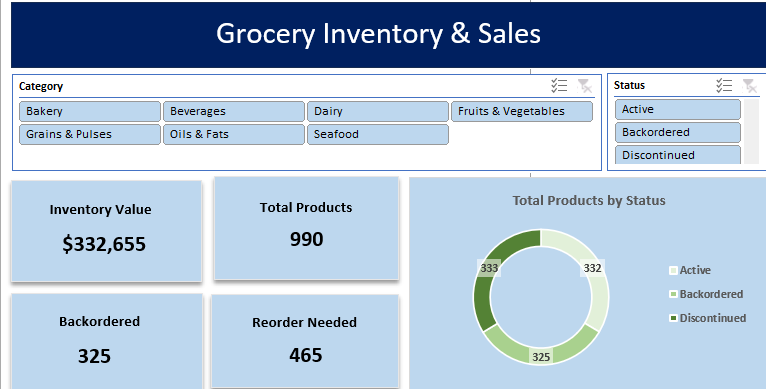
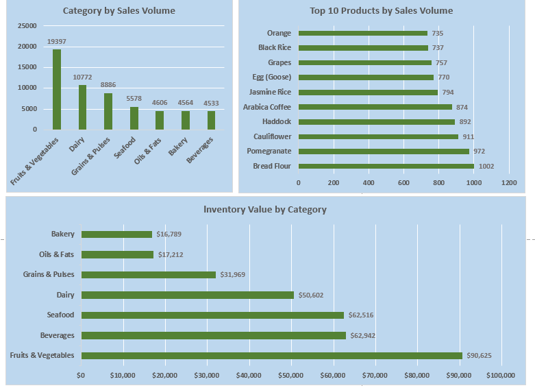

# Grocery Inventory and Sales Analysis

## 1. Project Overview

This project explores a grocery inventory dataset to understand inventory distribution, replenishment requirements, and product sales performance.

Using Microsoft Excel 2016, I created calculated columns and used PivotTables, PivotCharts, and slicers to analyze the data and develop an interactive dashboard.

## 2. Tools & Techniques

- Microsoft Excel 2016
- Excel Formulas and Calculated Columns
- PivotTables and PivotCharts
- Interactive Slicers
- Data Analysis and Visualization
- Dashboard Development

## 3. Dataset

- **Total Records:** 990 products
- **Product Categories:** 7
- **Suppliers:** 54

## 4. Data Preparation

Two calculated columns were added to support the analysis.

**Inventory Value**

Calculated the monetary value of current stock for each product.

```excel
=[@Unit_Price]*[@Stock_Quantity]
```

**Reorder**

Identified products requiring replenishment by comparing their current stock quantities with their reorder levels.

```excel
=IF([@[Stock_Quantity]]<=[@[Reorder_Level]],"Reorder","Sufficient")
```

Products with stock quantities equal to or below their reorder levels were classified as "Reorder"; otherwise, they were classified as "Sufficient".

## 5. Key Analysis

The analysis covers the following areas:

- Inventory status distribution across Active, Backordered, and Discontinued products.
- Replenishment requirements based on current stock levels and reorder thresholds.
- Inventory value and stock quantity by product category.
- Sales volume by product category.
- Top 10 and bottom 10 products by sales volume.
- Supplier analysis based on product count, stock quantity, and inventory value.
- Average inventory turnover rate by product category.

## 6. Key Findings

**Replenishment Requirements**

465 out of 990 products (47.0%) were flagged for reorder based on their stock quantities and reorder levels.

**Inventory Distribution**

Fruits & Vegetables recorded the highest inventory value, at approximately $90,625, making it the largest category by inventory value.

**Sales Performance**

Fruits & Vegetables also recorded the highest sales volume, with 19,397 units. Bread Flour was the highest-selling individual product, with 1,002 units.

**Inventory Status**

The dataset contained 332 Active, 325 Backordered, and 333 Discontinued products. Backordered products represented approximately 32.8% of the dataset.

## 7. Dashboard Preview

The interactive Excel dashboard provides an overview of inventory and sales performance through KPI cards, PivotCharts, and slicers.

Users can filter the dashboard by product category and inventory status to explore different segments of the data.

### Dashboard Overview



### Inventory and Sales Analysis



## 8. Recommendations

Based on the findings, the following areas could be considered for further review:

- Prioritize products flagged for reorder based on stock availability and recorded sales volume.
- Monitor inventory allocation across categories with higher inventory value.
- Investigate backordered products to better understand potential stock availability issues.
- Review higher-volume products to support inventory planning.

## 9. Conclusion

This project provided practical experience in Excel-based data preparation, analysis and visualization. Through PivotTables, calculated columns, and an interactive dashboard, I transformed raw inventory data into findings that can support further inventory management analysis.

## 10. Project Files

| File | Description |
|---|---|
| `Grocery_Inventory_and_Sales_Project.xlsx` | Excel workbook containing the dataset, calculated columns, PivotTables, and interactive dashboard |
| `Grocery_Inventory_and_Sales_Report.pdf` | Project report containing the analysis, key findings, recommendations, conclusions and dashboard screenshots
| `images/` | Dashboard screenshots |


## Data Source

Original dataset: (https://www.kaggle.com/datasets/salahuddinahmedshuvo/grocery-inventory-and-sales-dataset)


